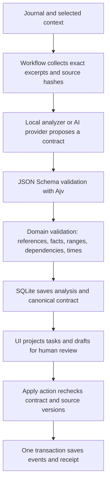

# Step 2: task, evidence, estimate, and planning contracts

This stage defines and integrates the data contracts for Calendar App 2.0. The existing calendar, journals, reminders, provider selection, and human Apply Drafts action remain available. The next stage implements a scheduler that considers actual calendar commitments and recurrence. This stage validates proposed plans; it does not solve calendar conflicts.

## 1. Define the task and engineering rules

Given the current journal, selected related journals, configured timezone, and availability, produce:

1. A readable summary and weekly reflection.
2. Actionable tasks linked to source excerpts.
3. Effort ranges with their basis, confidence, scope, and assumptions.
4. A proposed plan with blocks and an explicit reason for every unscheduled task.

Rules:

- Missing information stays unknown: `deadline: null`, unknown importance, or `effortMinutes: null`. Zero is not an unknown duration.
- Importance is separate from time urgency. Keyword importance is explicitly `inferred`; the legacy UI urgency projection is `unknown`.
- Activity does not prove completion. Completed/cancelled task states require an explicit verified status fact.
- A deadline requires a verified fact with the same timestamp. A date without a time/zone needs clarification rather than an invented midnight deadline.
- Source matching proves the excerpt exists, not that its claims are true or its instructions should be obeyed.
- Model and keyword estimates are tentative. They require assumptions and cannot claim high confidence.
- Estimates describe active work. `remaining_task` means all remaining effort; `next_session` means one session and never implies completion. External waiting time is not active effort.
- Every proposed block must fit availability, preserve buffers, reference its task's estimate, and contribute to the full expected effort of that estimate. Small windows cannot silently shorten a session.
- Dependencies cannot contain cycles. Dependent work requires explicit completion evidence or a full `remaining_task` allocation before it; a `next_session` allocation does not satisfy a dependency.
- All plans have `state: proposal`. The workflow records application separately in the existing batch receipt; the model cannot approve itself.

## 2. Contract architecture



The workflow owns source collection, evidence verification, input constraints, validation, persistence, and writes. The agent interprets the supplied evidence and proposes task/estimate/plan values. Provider output is untrusted input to these checks.

## 3. Read the schema definitions first

`server/contracts/schemas.cjs` is the single source of truth. It uses small helpers to build closed JSON Schema draft-07 objects: all declared fields are required, additional properties are rejected, arrays and strings have bounds, and IDs connect records.

Run `pnpm schemas:export` to generate the reviewable schemas in `docs/schemas/v1/`. A test prevents these exports drifting from the runtime source. `$id` URLs identify schemas locally; the app registers them with Ajv and does not fetch those URLs.

| Schema | Main fields | Why it exists |
| --- | --- | --- |
| `evidence.json` | ID, source type/ID/version, locator, excerpt, observed time, source time, verification, facts | Keeps a claim traceable and lets the workflow detect changed sources. |
| `task.json` | ID, title, description, status, evidence IDs, importance, deadline, estimate ID, dependencies, clarification questions | Describes what needs doing without confusing it with a calendar event. |
| `estimate.json` | ID, task ID, scope, basis, effort range, confidence, evidence IDs, assumptions, rationale | Makes uncertainty and the origin of a duration visible. |
| `plan.json` | ID, proposal state, timezone, date, availability, buffers, blocks, unscheduled tasks, warnings | Separates planning constraints from proposed calendar allocations. |
| `bundle.json` | `schemaVersion: 1`, evidence, tasks, estimates, plan | Validates the full graph together. |

`evidence.facts` supports normalized deadline, status, effort-minute, and importance values. A future authorized ingestion or confirmation tool must establish these facts; the model may reference supplied facts but cannot create verified evidence. The current journal collector deliberately supplies no normalized facts. Consequently it cannot establish a deadline, completion, or an evidence-based duration. It leaves deadlines unknown even if a sentence appears to mention one, until a reliable fact extraction/confirmation step is implemented.

An example tentative estimate:

```json
{
  "id": "estimate:1",
  "taskId": "task:1",
  "scope": "next_session",
  "basis": "local_heuristic",
  "effortMinutes": { "low": 45, "expected": 90, "high": 180 },
  "confidence": "low",
  "evidenceIds": [],
  "assumptions": ["Keyword estimate for one work session; confirm scope."],
  "rationale": "Provisional project work session."
}
```

This range is an explicit baseline assumption, not a statistical confidence interval. A cited duration alone also does not demonstrate applicability to the user's task; retrieval and evaluation must later assess that match.

## 4. Validate shape, then meaning

Read `server/contracts/validate.cjs` next.

1. Ajv compiles the schemas once. Validation does not coerce numeric strings, fill defaults, or remove unknown fields. Invalid output is rejected rather than silently repaired.
2. Registered formats check real calendar dates, ISO timestamps with offsets, named timezones, and HTTP(S) source URLs without embedded credentials. External consumers must register these custom formats too.
3. `assertBundle()` checks unique IDs, existing references, task/estimate ownership, graph cycles, matching deadline/status/importance facts, valid effort ranges, and evidence-source requirements.
4. It checks block duration, availability containment, hard deadlines, complete effort allocation, internal overlap/buffers, and dependency order. These are validity checks; choosing an optimal or conflict-free allocation against the actual calendar remains the scheduler's responsibility.
5. When provider output is validated, its evidence must equal the workflow's original records and its timezone/date/availability/buffer must preserve the workflow's inputs.

Validation failures raise `ContractError` with structured `issues`: `path`, `code`, and `message`. Invalid planning inputs receive HTTP 422 before any provider request. Invalid provider output triggers the existing local fallback with a visible caution. No real provider calls are needed for the automated tests.

## 5. Collect evidence and project the interface

Read `server/contracts/analysis.cjs`.

- `sourceVersion()` hashes journal type, date, title, and content. A hash detects source changes; it is not encryption or a trust score.
- `collectJournalEvidence()` stores exact sentence excerpts and source IDs. It labels them `source_matched`, records collection time separately from source time, and never manufactures facts.
- `contractAnalysis()` attaches the canonical contract and derives the old `tasks` and `scheduleDrafts` views.
- `projectContract()` supplies the current UI/API fields, keeping urgency unknown. Blocks obtain titles from referenced tasks rather than an independent model title.
- `assertAnalysis()` checks that compatibility views match the canonical records and that summary/caution shapes are valid.
- `assertEvidenceCurrent()` compares stored hashes and excerpts with all cited journals, including related journals.

The collector is bounded to 100 excerpts of at most 4,000 characters. Selection is sequential, not semantic retrieval. The local task detector remains a keyword baseline and extracts at most eight candidate tasks. Deduplication across analyses, robust language handling, source ranking, summary factuality, and injection resistance need later evaluation and agent work.

## 6. Integrate the analyzer and time handling

Read `server/journalAnalyzer.cjs`.

- Local analysis now builds canonical records, labels importance as inferred, and creates low-confidence estimate ranges for the next session.
- Statements that only report completion are excluded from its task candidates. This is a narrow heuristic, not general natural-language completion detection.
- The provider prompt requests the same contract and includes schemas and immutable evidence. This updates the output boundary; layered/versioned prompt skills and the bounded tool loop remain a later stage.
- Provider results go through `normalizeRemoteAnalysis()` instead of accepting arbitrary arrays.
- The baseline allocator keeps full session durations. Work that does not fit remains explicitly unscheduled. Empty availability means no allocation.

`server/contracts/time.cjs` converts the configured timezone's wall clocks to actual instants. `24:00` means next-day midnight. Ambiguous/nonexistent clocks at common daylight-saving transitions fail explicitly. The implementation validates clocks rather than choosing an arbitrary offset. Calendar recurrence expansion, historical timezone edge cases, calendar conflicts, task splitting strategies, and rescheduling policies need the dedicated scheduling stage.

## 7. Persistence and application

Read `server/store.cjs` and the analysis/apply routes in `server/index.cjs`.

- New contract records are checked before persistence under a transaction, including source freshness.
- Contract records fit inside the existing `analyses.data` JSON column. SQLite stays at database version 1; planning contract version 1 is a separate version. No existing personal database migration is run by this development task.
- The Apply callback runs under the existing SQLite writer lock. It revalidates canonical data and related sources, projects event fields, then the existing transaction inserts all events and the receipt.
- Events include `sourceAnalysisId`, `sourceTaskId`, `sourceEstimateId`, and `planningSchemaVersion` for traceability. Task/estimate IDs are scoped to an analysis; they are not yet durable cross-analysis task identities.
- Retries still return the original receipt, even if evidence changes after successful application.
- Legacy saved analyses remain readable and retain stage-1 application validation. GET analysis adds `contractStatus: legacy|versioned`; the UI invites reanalysis. Legacy records do not gain the new evidence guarantees retroactively.

Independent task/evidence CRUD tables and durable lifecycle editing are deferred until those user flows are designed. This avoids introducing a second copy of task state with unclear ownership.

## 8. Human review

`src/components/PlanningTasks.jsx` shows importance and its basis, effort range/scope/confidence, unknown deadlines, source excerpts, assumptions, clarification questions, and unscheduled work. React renders excerpts as text. Web locators are restricted to HTTP(S) by the contract.

`src/App.jsx` uses this component and displays draft times in the plan's timezone. The Apply action remains explicit. The new clarification questions are review prompts; a workflow for answering them and creating verified facts is still needed.

## 9. Verification and commands

```powershell
cd D:\project\Agent_summarize_planning
pnpm install --frozen-lockfile
pnpm schemas:export
pnpm test
pnpm lint
pnpm build
pnpm smoke:desktop
pnpm dev
```

Tests cover schema export parity, closed objects/types, impossible dates, timezone handling, broken references, dependency cycles, fabricated facts/evidence, estimate uncertainty, invalid effort allocations, stale related sources, persistence atomicity, legacy compatibility, provider fallback, and review text. Existing calendar/security/migration/retry tests remain in the suite. Desktop smoke verifies the real preload/API/analyze/apply path using synthetic records in a temporary database.

Verified on 2026-10-11: 40 tests passed (10 frontend/analyzer, 30 server), lint was clean, the production build succeeded, and the real Electron smoke passed. The contract tests also validate the complete synthetic API example. No external provider or personal activity was used in these checks.

The next implementation is deterministic scheduling against current calendar commitments, with a calendar snapshot and revalidation at application time. Then add confirmed facts, durable task identities, versioned skills/prompts, consented activity ingestion, retrieval, researched estimates, and quality evaluation.

References: [JSON Schema object rules](https://json-schema.org/understanding-json-schema/reference/object) and [Ajv schema management](https://ajv.js.org/guide/managing-schemas.html).
