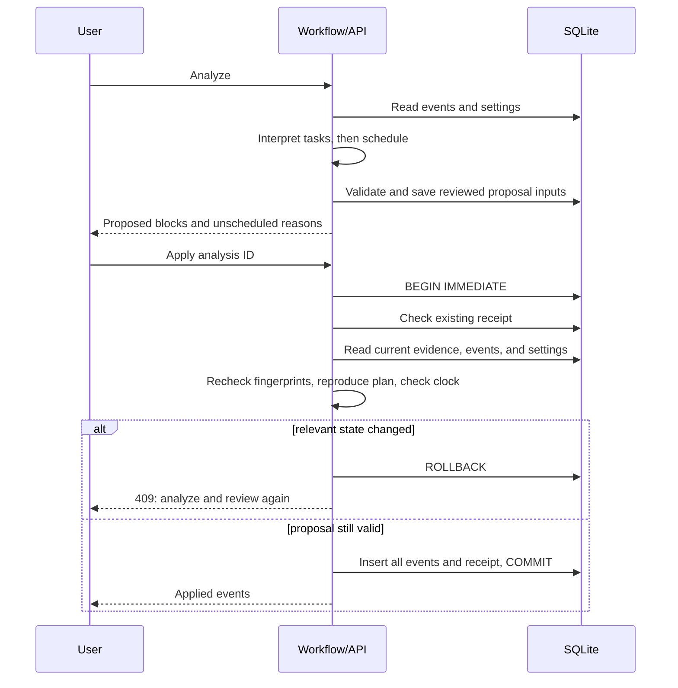

# Step 3: deterministic scheduling around existing calendar events

This completes the scheduler portion of roadmap step 2. Task interpretation and effort estimation remain agent responsibilities. The workflow now owns calendar allocation using a reproducible algorithm, and validates the reviewed allocation again before writing.

## 1. Define the scheduling problem

Inputs: a validated contract (tasks, estimates, evidence, and planning constraints), existing calendar events, and an explicit `notBefore` timestamp.

Output: proposed blocks and explicit unscheduled reasons. With identical inputs, the same blocks, reasons, warnings, and calendar fingerprint are produced. The scheduling function does not read the current clock, call a model, or write a database.

The API captures the current time once for each analysis. Historical journals default to planning today in the configured timezone; future journals keep their date. A request can specify `targetDate`. Explicitly selecting an elapsed day produces unscheduled work rather than new blocks in the past. Starts round upward to whole minutes.

## 2. Scheduling policy

1. Validate task/evidence/estimate relationships and dependency cycles.
2. Convert availability to UTC instants using the plan's named timezone. Sort and merge overlapping or adjacent windows.
3. Resolve existing events, including repeat instances whose original anchor is outside the day being planned.
4. Add the plan buffer before and after each occupied interval, then merge occupied intervals.
5. Subtract occupied time from availability. Apply `notBefore` to the remaining intervals.
6. Select ready tasks by earliest explicit deadline, then importance (`high`, `medium`, `low`, `unknown`), then task ID using a locale-independent comparison. Dependencies control readiness.
7. Allocate the earliest gap that can hold the full expected effort. No session is silently shortened or split.
8. Subtract the allocated block and its buffers before selecting another task. A task that does not fit is skipped so smaller tasks can still use gaps.
9. Emit explicit reasons for unknown effort, blocked/inactive tasks, unmet dependencies, and insufficient capacity. Hard deadlines constrain the end time. Missed target deadlines produce a warning.
10. Validate the final contract and derive the existing UI draft fields.

This is a greedy policy, not an optimization solver. It provides predictable allocations; it does not guarantee maximum utilization or the best possible global task ordering. A next-session estimate never satisfies a dependency as though the entire remaining task were finished. Clarification questions remain visible; they are not automatically treated as blockers when a tentative estimate is available for human review.

### Example in the user's configured timezone

Availability: **20:00–24:00**. Existing meeting: **20:30–21:30**. Buffer: **15 minutes**. Expected session: **90 minutes**.

| Interval | Meaning |
| --- | --- |
| 20:00–20:15 | Free, but too small for this session |
| 20:15–21:45 | Meeting plus buffers |
| 21:45–23:15 | Scheduled 90-minute session |
| 23:15–23:30 | Buffer after the planned session |
| 23:30–24:00 | Remaining free time |

The event stays unchanged. The interface still requires Apply Drafts to create the proposed session.

## 3. Read the code step by step

### `server/scheduler.cjs`

- `mergeIntervals()` sorts and combines availability/busy intervals. Copying records keeps the input unchanged.
- `subtractIntervals()` walks each available window and emits gaps between busy intervals. Intervals use `[start, end)`: an event ending at a boundary does not overlap a block starting there when the buffer is zero.
- `planningRange()` calculates the day boundary plus buffer margins, including events immediately outside the day that can affect availability.
- `calendarContext()` expands events, buffers their intervals, merges availability, and computes a fingerprint of effective busy time within that availability.
- `inputBundle()` validates the input records while neutralizing model allocations. Scheduling owns the final blocks and reasons.
- `scheduleBundle()` implements the ready-task loop. It clones the input and takes `events` and `notBefore` explicitly.
- `scheduleAnalysis()` adds workflow-owned scheduling metadata and regenerates compatibility projections.
- `assertScheduleCurrent()` checks settings, calendar fingerprint, deterministic plan reproduction, elapsed start times, and current conflicts.
- `assertLegacyDraftsCurrent()` provides live overlap checks for old records without versioned contracts.

The fingerprints represent scheduling-relevant state. Renaming a meeting, changing its notes, or adding an event outside availability does not invalidate an otherwise identical free-time plan. Adding/removing/moving occupied time within availability does. For default-availability plans, changes to default windows invalidate the plan; request-specific windows remain independent of later default-window edits. Timezone changes invalidate both.

### `server/eventOccurrences.cjs`

Expands the app's five repeat presets: none, daily, weekly, monthly, and yearly. It jumps directly to dates around the requested range rather than iterating from an old anchor through every intervening year.

- Daily/weekly instances use calendar-day steps.
- Monthly/yearly instances preserve the original day/month anchor. A monthly January 31 event skips February and returns on March 31. A yearly February 29 event occurs in leap years.
- New/updated recurring events store `recurrenceTimezone`. Legacy anchors without that field use the current planning timezone until explicitly updated.
- Instances retain the original elapsed duration, including seconds and milliseconds. They keep their local start clock across daylight-saving changes.
- Nonexistent recurring local clocks are skipped. Both possible offsets of an ambiguous future clock are reserved conservatively. The original occurrence already has a known offset and uses it.
- All existing event categories are treated as busy. There is no new free/busy flag, all-day event type, cancellation override, end date, exception list, or full RRULE support.
- Planning is bounded to 10,000 candidate events, 4,096 recurring date candidates, and recurring durations of at most 366 days. Invalid selected records and exceeded bounds fail explicitly with HTTP 422; events are not silently ignored.

The missing-date policy follows the recurrence guidance in [RFC 5545 section 3.3.10](https://www.rfc-editor.org/rfc/rfc5545#section-3.3.10). This implementation covers the app's preset repeats, not full iCalendar recurrence support.

### `server/contracts/time.cjs` and `validate.cjs`

Time conversion now preserves seconds/milliseconds for repeat anchors and caches bounded timezone formatters. Availability still rejects ambiguous/nonexistent clocks. Repeat expansion uses candidate offsets conservatively. Unusual historical timezone transitions and missing/ambiguous day boundaries can fail explicitly rather than choosing an arbitrary offset.

The contract validator now checks containment against the merged union of availability windows, so a valid block can span overlapping or adjacent windows. Existing estimate, evidence, dependency, deadline, buffer, and task-accounting checks remain in place.

### `server/journalAnalyzer.cjs`

The old keyword allocator has been removed. Both local and remote analyses use the same scheduler. The provider prompt asks for interpreted tasks and estimates with empty proposed blocks; the workflow computes calendar times. Valid provider-proposed allocations are replaced by deterministic allocations, while malformed provider output still triggers the validated local fallback.

This improves allocation reliability. It does not make keyword estimates accurate, extract confirmed deadlines, or prove model summary factuality. Those remain later agent/evidence/evaluation work.

## 4. Database and API integration

`store.listPlanningEvents()` includes overlapping one-off events and older recurring anchors. A regular date-overlap query would miss repeat instances because only the original anchor is stored. The current query uses the existing event indexes and JSON repeat field; a dedicated indexed recurrence column can be added if measured scale requires it.

`POST /api/journals/{id}/analyze` accepts optional `targetDate` and availability. It validates planning inputs, captures a clock value and calendar candidates, calls interpretation, then stamps the deterministic schedule. If settings/calendar/evidence change during provider work, the result is rejected before persistence. The store rechecks calendar/settings under its writer transaction too.

New analyses contain a separate `scheduling` object:

```json
{
  "version": 1,
  "algorithm": "greedy-v1",
  "calendarFingerprint": "64 hexadecimal characters",
  "settingsFingerprint": "64 hexadecimal characters",
  "availabilitySource": "settings",
  "notBefore": "2026-10-11T10:00:00.000Z"
}
```

Its schema is exported to `docs/schemas/v1/scheduling.json`. Hashes detect changed state; they are not encryption, signatures, or proof of user approval. Contract version and SQLite database version stay at 1. Existing analysis records need no migration.

## 5. Why Apply checks again



The event/settings reads occur under the same writer lock as event insertion. Another process cannot write competing events between validation and commit. Apply never silently moves the blocks the user reviewed. A retry of a successful application returns its original receipt before checking newly changed calendar state.

Older versioned analyses receive live calendar/buffer checks but have no historical fingerprint or new elapsed-time guard. Older raw drafts receive live event overlap and internal overlap checks. Reanalysis upgrades them to the full new scheduling policy. Manual event CRUD continues to allow overlapping events; the conflict guarantee applies when creating blocks through the planning Apply action, not to later user edits or manual event creation.

## 6. Verification and remaining work

Verified on 2026-10-11: **68 tests passed** (10 frontend/analyzer and 58 server), lint was clean, and the production build succeeded. Real Electron smoke scheduled around an old weekly anchor, rejected a newly conflicting meeting, then applied/replayed the restored valid plan through the preload bridge.

Tests cover merged availability, occupied/buffer subtraction, exact boundaries, cross-midnight events, full effort, smaller-task fallback, stable tie-breaking, dependencies, deadlines, timezone/DST/repeat behavior, malformed calendars, permutations over 30 synthetic calendars, state changes during analysis, and competing applications. A two-process SQLite test confirmed only one competing plan commits. All test records are synthetic; no personal database or external model was used.

```powershell
cd D:\project\Agent_summarize_planning
pnpm test
pnpm lint
pnpm build
pnpm smoke:desktop
pnpm dev
```

Current scope is one planning day with unsplit sessions. Next improvements: durable task identities and confirmed facts, optional multi-day allocation and task splitting, recurrence visibility/editing in calendar UI, configurable scheduling policy, and evaluation of estimates/summary quality. The existing calendar UI still edits stored recurrence anchors; scheduler occurrence expansion does not add independent occurrence records or change reminder recurrence behavior.
