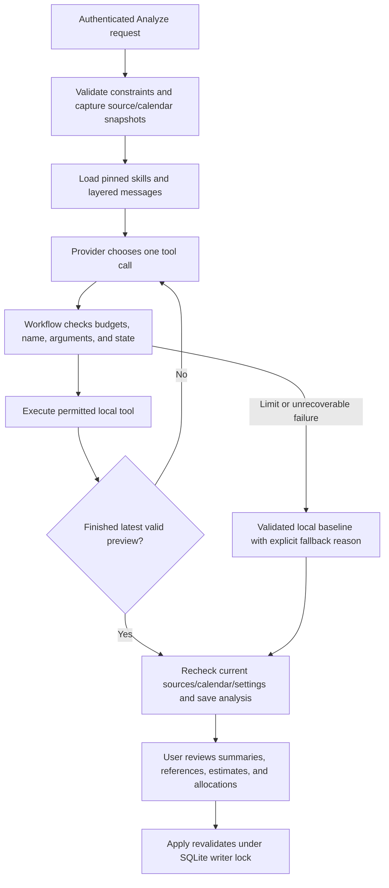

# Step 4: versioned skills and a bounded tool workflow

## What this stage delivers

Calendar App 2.0 now uses two pinned application skills and a controlled tool loop
for remote journal analysis. The existing deterministic allocator and reviewed,
atomic Apply action remain the final scheduling and writing gates.

The skills are project artifacts, packaged under `server/**`; they are not installed
as personal Codex skills. No additional agent framework or paid tool service is
needed. This implementation uses Node's native fetch/AbortController, the existing
open-source Ajv validator, and provider function-calling protocols.

## 1. Define the agent

| Component | Definition |
| --- | --- |
| Role | Careful journal summarizer and personal task planner |
| Goal | Produce source-linked summaries and reviewable follow-up work |
| Instructions | Workflow policy, daily-summary skill, task-planning skill, server limits |
| Tools | read_evidence, get_planning_context, preview_plan, finish_analysis |
| Input | Selected journal identity; workflow-owned evidence and planning snapshots via tools |
| Output | Validated analysis contract v1, deterministic proposal, summary references, workflow provenance |
| Permission | Read the supplied snapshots and calculate proposals; calendar writes require the existing user Apply action |

The model chooses what evidence pages to read and how to interpret them. Workflow
code defines permissions, state transitions, limits, validation, calendar allocation,
and persistence. Neither prompts nor provider replies can expand tool permissions.

## 2. Version instructions separately from data

Start with [`server/skills/registry.json`](../server/skills/registry.json): it pins
both skills to `1.0.0` and selects the policy prompt version (currently `1.0.1`).
See [the GLM update](GLM_CONFIGURATION.md) for the default provider and live checks.

- [`daily-summary/1.0.0/SKILL.md`](../server/skills/daily-summary/1.0.0/SKILL.md):
  distinguish reported activity from intent, summarize the selected journal only,
  cite sources, and describe partial contextual coverage honestly.
- [`task-planning/1.0.0/SKILL.md`](../server/skills/task-planning/1.0.0/SKILL.md):
  extract up to eight actionable tasks, preserve dependencies and unknown facts,
  distinguish session effort from remaining-task effort, and inspect a preview.
- [`prompts/1.0.0/policy.md`](../server/skills/prompts/1.0.0/policy.md): source text
  is data, finalization requires validation, and calendar writes need human review.

[`agent/skills.cjs`](../server/agent/skills.cjs) loads only the pinned repository
paths. `buildMessages()` layers trusted policy, both skills, and hard limits into
the system message. A separate user message carries the selected journal's identity
and source counts. Journal excerpts arrive in tool results, never in trusted
instruction layers. Line endings are normalized before SHA-256 hashing.

Each analysis records skill names, versions, instruction hashes, policy version,
and combined prompt hash. These hashes cover instructions and limits, not personal
journal text. Git holds the actual instruction versions; a hash does not restore
old content by itself.

**Updating a skill:** create a new version directory, revise its frontmatter, run
the behavioral checks, then change the registry pin. Preserve previous directories
for rollback. Use `feat: ...`, `fix: ...`, or `docs: ...` commits. Do not edit a
released version in place. Registry rollback affects new analyses; saved proposals
retain their original provenance and normal source/calendar validity checks.

## 3. Define tools and state

Read [`agent/tools.cjs`](../server/agent/tools.cjs) next.

| Tool | Arguments | Effect |
| --- | --- | --- |
| read_evidence | offset, limit (1–20) | Return a page from the immutable evidence snapshot and nextOffset |
| get_planning_context | Empty object | Return date, timezone, availability, buffered busy intervals, and cutoff; omit event titles/notes |
| preview_plan | proposal | Validate summaries, citation IDs, tasks, estimates, and semantic links; calculate and retain a deterministic preview |
| finish_analysis | previewId | Return the latest successful validated snapshot and end the loop |

There is no dynamic function lookup, eval, shell, arbitrary file/URL access, web
search, browser ingestion, or event-write tool. Unknown names and extra arguments
are rejected. Tool schemas are derived from the existing contract schemas and
validated locally; provider-side schema enforcement is an additional convenience.

The proposal schema intentionally omits evidence records, plan fields, allocations,
and workflow metadata. The workflow assembles those fields. The model cannot change
the planning date or availability by submitting a different contract.

Before previewing, the agent must read evidence and inspect constraints. References
must identify evidence actually read during this run; the main summary's references
must belong to the selected journal. Factual deadlines, status, importance, and
evidence-based estimates still pass the stage-2 semantic gates. No verified fact
means no asserted deadline. A new preview attempt invalidates the previous preview,
including malformed revisions. Finish can only select the latest valid preview ID.

## 4. Run a bounded loop

[`agent/runtime.cjs`](../server/agent/runtime.cjs) owns the following fixed policy.
HTTP bodies and provider instructions cannot override it.

| Limit | Value |
| --- | --- |
| Provider turns | 12 |
| Tool calls | 16; one per turn, so the default turn cap is reached first |
| Tool validation errors | Stop on the third error; at most two repair opportunities |
| Overall remote workflow time | 60 seconds |
| Each provider request, including body reading | 30 seconds or remaining overall time |
| Requested output per provider turn | 4,096 tokens |
| Tool arguments | 64 KiB |
| Each tool result | 96 KiB |
| Provider response body | 256 KiB |
| Conversation transcript | 512 KiB |
| Each outgoing JSON body | 768 KiB |
| Total outgoing JSON bodies | 3 MiB |

The runtime checks limits before requests and after replies/tools. A timer races the
request and aborts it on timeout, including stalled body reads. The provider adapter
streams response bodies through a byte counter rather than trusting Content-Length.
Parallel batches and duplicate call IDs are rejected before tool execution.

Recoverable argument/contract mistakes produce short path/code feedback, which is
returned as a tool result for correction. Capacity shortages are successful previews,
not errors. Provider failures, text-only answers, truncation, timeout, or exhausted
budgets discard unfinished remote work and invoke the validated local baseline.
No automatic transport retries add hidden requests or extra budget.

These are resource bounds, not a dollar ceiling or precise tokenizer accounting.
Input is bounded in bytes, and each request configures an output token cap. Model
pricing, input token counts, and provider usage/cost telemetry remain future work.

## 5. Adapt provider protocols

[`agent/providers.cjs`](../server/agent/providers.cjs) keeps protocol handling outside
the domain tools:

- OpenAI/Groq: send function declarations; append assistant tool calls and matching
  `role: tool` messages with `tool_call_id`. Require calls and disable parallel calls.
  OpenAI uses strict function schemas; Groq still receives local schema validation.
- Gemini: send `parametersJsonSchema`, return native function responses, preserve
  entire signed model content across turns, and retain native function IDs when
  present. Missing optional IDs receive unique local correlation IDs. The API key
  goes in a header rather than the URL.

Official protocol references: [OpenAI function calling](https://developers.openai.com/api/docs/guides/function-calling),
[Groq local tool calling](https://console.groq.com/docs/tool-use/local-tool-calling),
[Gemini function calling](https://ai.google.dev/gemini-api/docs/function-calling), and
[Gemini thought signatures](https://ai.google.dev/gemini-api/docs/generate-content/thought-signatures).

Existing provider/model environment settings continue to select the adapter. The
selected model must support this protocol and the configured output limit. Unsupported
models or missing credentials produce an explicit local fallback. No credentials
are exposed in saved metadata or errors.

## 6. Integrate with analysis, storage, and review

[`journalAnalyzer.cjs`](../server/journalAnalyzer.cjs) validates input constraints,
collects evidence, loads skills, selects the adapter, and runs the loop. Successful
remote results and fallback results both pass `assertAnalysis()`.

The local baseline remains deterministic keyword interpretation; it does not execute
Markdown instructions through an LLM. It records the active policy/skill versions,
uses selected-journal excerpts for its main summary, and labels contextual coverage
as partial. Its durations remain provisional heuristic session estimates.

`agentWorkflow` is a separate closed metadata schema, keeping contract schema and
SQLite storage versions at v1. Saved fields include outcome, stop reason, counts,
elapsed milliseconds, outgoing bytes, references, and a redacted trace of tool
name/turn/status. Raw arguments, provider text, source excerpts, and hidden reasoning
are not stored in this trace. The existing analysis contract still stores its
authorized evidence snapshot for review and invalidation.

The authenticated Analyze route still checks source/calendar/settings changes before
saving. No database writes occur inside tools. Apply still uses the existing SQLite
transaction, occupancy checks, and idempotent receipt. Legacy analyses without
workflow metadata remain readable.

[`AnalysisSummaries.jsx`](../src/components/AnalysisSummaries.jsx) exposes expandable
source excerpts beside the two summaries. The contextual section is labeled
"Journal context". Hashes and low-level traces stay out of the normal review flow.

## 7. Verification and remaining work

Tests cover protocol serialization for all three providers, missing Gemini IDs,
signed parts, paging, unread/fabricated references, fact gates, tool permissions,
preview invalidation, error repairs, finalization, limits, abort behavior, truncated
output, fallback redaction, local provenance, and API save/review/apply/replay.
The Electron smoke also checks skill loading through the real main/preload/renderer
path. Release packaging includes `server/**`; an installed release has not been
tested in this stage.

This is a workflow/security evaluation with synthetic providers. It does not prove
real-model summary quality, planning accuracy, citation entailment, or live-provider
compatibility for every configurable model. Source reference validation checks
identity and scope; it cannot prove every prose claim follows from the excerpt.

Still needed: confirmed fact ingestion, durable task identity and deduplication,
authorized personal retrieval and web research, representative quality datasets,
claim/estimate evaluations, provider cost tracking, consent-aware ingestion,
deployment monitoring, and CI release gates. The deterministic scheduler retains
its single-day, unsplit greedy policy. Do not call tentative estimates researched.
