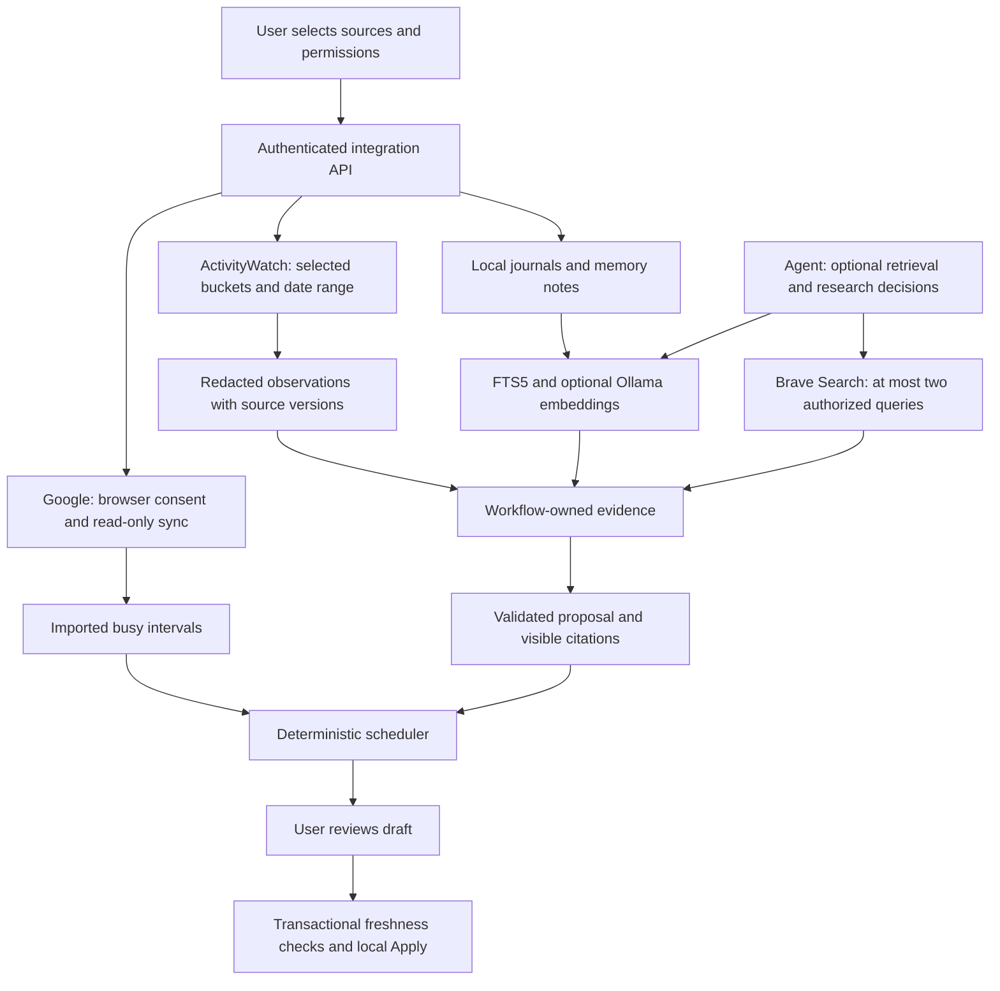

# Step 5: authorized sources, personal retrieval, and cited research

This stage implements ActivityWatch ingestion, Google Calendar OAuth, hybrid
personal retrieval, and web research in Calendar App 2.0. Credentials can be added
later. Nothing needs to connect to your accounts while you study the code.

## 1. Follow the data flow



The workflow controls consent, source acquisition, budgets, validation, scheduling,
and writes. The agent chooses relevant queries and interprets retrieved material.
External text cannot change permissions or become instructions.

The original four tools remain. `search_personal_memory` and `research_web` are
declared only when the user permits them for that analysis. Neither writes events.
Their results become immutable evidence; retrieval after a preview invalidates it.
The agent must generate a new preview and explicitly finish before a result is saved.

## 2. Add durable storage first

Read `server/store.cjs`, then `server/integrations/storage.cjs`.

The SQLite migration now advances v1 to v2 under the existing writer lock. Existing
settings, events, journals, analyses, and receipts are preserved. Schema creation and
version advancement roll back together if any migration statement fails. Canonical
planning contracts remain v1; their version is independent of the database version.

New tables hold integration state, encrypted Google tokens, activity observations,
Google busy intervals, memory notes/chunks, and an FTS5 keyword index. Imported busy
events stay separate from editable local events. The frontend requests them for
display as generic read-only busy time; titles, descriptions and attendees are not
persisted. They do not produce duplicate desktop notifications.

Source content hashes are checked inside Save and Apply transactions. A changed or
deleted memory note, expired/removed activity, or revised calendar occupancy rejects
the proposed write. The existing idempotent receipt check still runs first, so an
already applied batch can safely be retried.

## 3. Ingest observations, without claiming accomplishments

Read `server/integrations/activity.cjs`.

1. Query the fixed loopback ActivityWatch service on port 5600.
2. Let the user select 1–4 supported buckets, including exactly one AFK bucket.
3. Require explicit import consent, and separate consent for browser domains.
4. Read a bounded range: at most seven days, within the previous 30 days. Request
   2001 events per bucket to detect the 2000-event limit; reject incomplete snapshots.
5. Remove titles, full URLs, paths, queries and fragments before storing anything.
6. Intersect observation time with non-AFK intervals. Sweep interval boundaries to
   merge overlapping heartbeats and avoid adding browser time to app time.
7. Replace overlapping imported snapshots atomically; repeating an import is safe.

Choose buckets from the same device. Domain observations take precedence during
overlap; the stored app/domain time is an approximation of observed presence.
Missing activity is not interpreted as inactivity. At most 20 observations from
the selected journal's date enter an analysis, so this is partial context.

Records expire after 30 days; cleanup runs at startup and hourly while the API is
running. Expired records are excluded from analysis and rejected at Apply immediately.
Remove imported activity clears consent and related saved analyses, and prevents a
pending import from saving a late response. Applied events and existing backups are
retained. SQLite deletion is logical deletion, not secure erasure of disk pages.

The normalized evidence has `sourceType: activity`, `verification: source_matched`,
and `facts: []`. Seeing an app or page never proves completion, a deadline, or effort.

## 4. Connect Google through the browser

Read `server/integrations/google.cjs` and its `vault()` helper.

`connect()` creates a random state and PKCE verifier, starts a temporary listener on
127.0.0.1 with an OS-selected port, and returns a Google authorization URL. Electron
opens the link in the system browser. The user grants access there.

The callback listener is separate from the authenticated app API because Google's
browser redirect cannot carry the app's bearer token. It accepts only the expected
GET path, Host and single-use state. It expires after five minutes. A declined,
cancelled, mismatched, replayed, or late callback cannot create a connection.

Only these scopes are requested:

- `calendar.calendarlist.readonly`: select calendars.
- `calendar.events.readonly`: retrieve their events.

The authorization code is exchanged using the verifier. Access and refresh tokens
are encrypted with AES-256-GCM in SQLite. `INTEGRATION_ENCRYPTION_KEY` is a separate
32-byte local key in the ignored .env. Tokens and keys never appear in renderer
status, logs, prompts, or Git. `setup:env` generates a missing key without printing
it and refuses to silently rotate an existing invalid key. Keep the key available
when restoring encrypted database backups; local file permissions remain necessary.

`sync()` selects up to four calendars and a range of at most 31 days. Google expands
recurrence with `singleEvents=true`; bounded pagination must finish successfully
before the previous cache is replaced. Transparent, cancelled and self-declined
events are excluded. All-day boundaries use the calendar timezone, including DST.
Unsupported time representations fail the whole sync instead of losing a commitment.

Once connected, planning requires selected calendars and a successful sync covering
the entire planning day plus 15 minutes before and after for scheduling buffers.
The cache expires after 30 minutes. Refresh before planning
or Apply. This stage uses manual sync; it does not claim real-time Google freshness.
OAuth account changes clear the previous busy cache atomically. Disconnect deletes
local tokens/cache and attempts remote revocation; a failed revocation is reported.

## 5. Retrieve personal context with two complementary ranks

Read `server/integrations/memory.cjs` and the memory methods in `storage.cjs`.

1. Save short text notes for goals, project scope and prior experience.
2. Explicitly rebuild the index to include local journals.
3. Split text into 1200-character chunks with a 300-character overlap. Each chunk
   has a stable source ID and content version.
4. Rank keyword matches with SQLite FTS5/BM25, using escaped query terms.
5. Optionally embed chunks through the fixed local Ollama `/api/embed` endpoint.
6. Compare a query embedding to compatible stored vectors using cosine similarity.
7. Fuse both ranked lists with reciprocal rank fusion: add `1/(60 + rank)` per list.
8. Return at most eight excerpts with their source versions and relevance scores.

Vectors must be finite, nonzero, and have matching model names, installed model digests
and dimensions. Nomic document/query prefixes are applied separately. Embedding
inputs are not silently truncated. The optional index job has a 50-second budget,
at most 256 embedded chunks, and eight texts per batch. Larger indexes retain keyword
coverage with explicit partial embedding status. Storage is capped at 100 notes,
200 indexed sources and 1000 chunks.

Without Ollama or a pulled model, keyword search still works. Missing semantic
results are explicitly reported as lexical mode. Relevance is a retrieval rank,
not confidence in a claim. Rebuild after journal edits; stale chunks are excluded.
The `unicode61` tokenizer does not provide specialized Chinese word segmentation;
evaluate a multilingual embedding model and representative Chinese queries if needed.

Notes remain text evidence with empty facts. A note mentioning an effort or deadline
does not automatically become a verified structured fact. Confirmed fact entry and
measured task outcome records are the next foundation for calibrated estimates.

## 6. Research with traceable uncertainty

Read `server/integrations/research.cjs`, `common.cjs`, and `agent/tools.cjs`.

The web tool uses a fixed Brave Search endpoint with a server-side key. Manual
research sends only the query shown in the UI after consent. Agent research is a
separate per-analysis permission: generated queries may disclose task context.
Use topic-only queries and avoid private identifiers; that prompt instruction is
not a formal guarantee of automatic redaction.

Each analysis allows at most two memory searches and two web searches within the
existing 12-turn, 16-tool-call, 60-second workflow budget. Search responses contain
at most three sources each. Direct search is limited to ten queries per minute per
running API instance. Network calls prohibit redirects and enforce body/time limits;
async tools receive the remaining workflow budget and an abort signal.

Results preserve clickable public HTTPS URLs, titles, snippets and retrieval time.
They are explicitly `snippet_only`, unverified, with low confidence and an explanation.
The workflow records the same source text in contract evidence and research metadata;
validation rejects mismatches. React renders snippets as text.

A generic task duration found on the web cannot establish your personal deadline
or remaining effort. This stage does not fetch arbitrary page URLs, verify full
articles, or assert that a citation entails every sentence of a generated summary.
Page verification and explicit user-confirmed facts should precede stronger claims.

## 7. Connect the API, UI and pinned instructions

Read `server/integrations/service.cjs`, `server/index.cjs`, `electron/apiBridge.cjs`,
`src/api.js`, and `src/components/IntegrationSettings.jsx` in that order.

The service registers authenticated setup/import/search routes and creates scoped
analysis context. Electron permits only explicitly listed routes. In Journals,
**Sources and connections** provides setup, consent, selection, import/sync, deletion,
local search and cited research. The three analysis-source checkboxes start disabled.
Activity/memory excerpts enabled for a remote provider can leave the machine.

`ResearchSources.jsx` displays source links and confidence; `AnalysisSummaries.jsx`
displays referenced source excerpts. The daily-summary and task-planning application
skills and policy are now pinned at **1.1.0**. Prior versions remain unchanged.
These are application skills; they do not install personal Codex skills.

The local rule baseline still uses journal wording to propose tasks. Optional agent
queries are decisions made in the remote tool workflow; merely enabling a checkbox
does not force a search. Manual local memory and web search are available separately.

## 8. Configure later

In `D:\project\Agent_summarize_planning`:

```powershell
pnpm setup:env
# Edit the ignored local .env with Google desktop client credentials and a Brave key.
# Optional local semantic search, after installing Ollama:
ollama pull nomic-embed-text
pnpm dev
```

For Google: enable Calendar API, configure the consent screen, create a Desktop app
client, add your account as a test user, and provide GOOGLE_CLIENT_ID plus the issued
GOOGLE_CLIENT_SECRET if present. For Brave: provide BRAVE_SEARCH_API_KEY. Restart
after environment changes. Installed Electron uses its own userData configuration;
editing the development .env does not reconfigure an installed app.

No live activity collection, account connection, model download or research request
was needed for implementation. Actual OAuth consent, installed ActivityWatch/Ollama
compatibility and search billing/configuration require a subsequent live setup check.

## 9. Verification and the next engineering work

The synthetic integration suite covers migration preservation/rollback, AFK/redaction,
idempotence and import revocation, hybrid ranking/degradation, source invalidation,
token encryption, loopback state/PKCE/replay/cancellation, refresh/revocation, calendar
pagination/DST/coverage/Apply rejection, cited research, request limits and async tool
budgets. Frontend tests cover setup states, consent, safe text and citation links.
Electron smoke checks integration IPC, local retrieval/deletion and the rendered setup.

Verification for this stage: **120 tests passed** (16 frontend, 104 server), lint,
production build, hidden Electron smoke and Git whitespace checks. All integration
transports were mocked or restricted to synthetic loopback test servers.

These checks establish implementation behavior. They do not establish better summary
quality or accurate real-world effort estimates. Next build a representative evaluation
set (summary coverage, unsupported claims, retrieval Recall@k, estimate error), explicit
fact confirmation, stable task identities/outcomes, and release/monitoring gates.
Live complete GLM planning remains subject to the latency limitation documented in
`GLM_CONFIGURATION.md`; the new integrations do not resolve that provider behavior.

API decisions were checked against primary references:

- [ActivityWatch REST API](https://docs.activitywatch.net/en/latest/api/rest.html)
- [Google installed-app OAuth and PKCE](https://developers.google.com/identity/protocols/oauth2/native-app)
- [Google Calendar event listing](https://developers.google.com/workspace/calendar/api/v3/reference/events/list)
- [Google Calendar list scopes](https://developers.google.com/workspace/calendar/api/v3/reference/calendarList/list)
- [Ollama embedding endpoint](https://docs.ollama.com/api/embed)
- [Ollama installed model digests](https://docs.ollama.com/api/tags)
- [Nomic embedding task prefixes](https://huggingface.co/nomic-ai/nomic-embed-text-v1.5)
- [Brave Search API](https://api-dashboard.search.brave.com/app/documentation/web-search)
