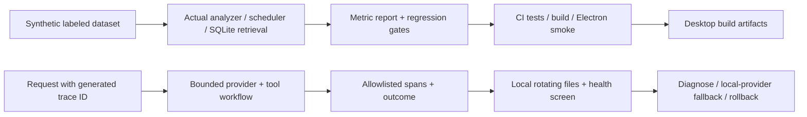

# Step 6 — evaluation, CI gates, tracing, monitoring and recovery

## 1. What this stage proves

An agent pipeline needs two separate kinds of evidence: engineering correctness and useful model output. Tests can prove that a schema rejects an invented deadline, a plan avoids an event, or Apply is atomic. They cannot prove that a summary includes every important point, or that a 90-minute estimate reflects a person's real work.

This stage supplies reproducible regression evaluation and operational tools. It also records failures, rather than treating a safe fallback as evidence of remote AI quality. App version stays 0.3.0, SQLite schema stays 2, contracts stay 1, and pinned prompts/skills stay 1.1.0. No new database migration is needed for telemetry.



## 2. Start with the dataset

`evaluation/dataset.v1.json` holds 20 invented journal cases, 10 scheduler scenarios, 6 actual lexical retrieval queries, and 3 rank-fusion scenarios. There is no personal data in this file. Gate cases cover empty notes, multiple actions, completed work, negation, cancellation, unknown deadlines, capacity, event buffers, dependencies, recurring events and DST.

Eight challenge cases measure Chinese notes, implicit actions, past events, salient text beyond the first three sentences, prompt injection, explicit deadlines and duplicates. They stay visible in every offline report. They are diagnostic cases; passing the regression gate does not imply they are solved. The dataset is a development set authored with the implementation. An independent held-out benchmark still needs separate examples and human annotation.

`evaluation/README.md` defines labels, metrics, thresholds, a human-review rubric and requirements for collecting actual task outcomes. Task matching and summary phrase coverage are transparent proxies. They do not establish semantic entailment, citation correctness beyond reference validity, or duration accuracy.

## 3. Follow the evaluation code

1. `evaluation/runner.cjs: inputFor()` supplies a fixed planning date, clock boundary, availability and synthetic busy events. Offline runs force the local provider and restore the caller's environment afterward; they do not load `.env` or call external services.
2. `scoreAnalysis()` calls the real contract validator, matches each gold task to at most one proposed title, penalizes duplicates, checks summary anchors and evidence references, and records outcome/stop reason. The local uncertainty check requires unknown deadlines and low-confidence estimates.
3. `schedulerBundle()` turns synthetic confirmed facts into canonical evidence/tasks/estimates. `scheduleSafe()` independently checks full effort, availability, event buffers, dependencies and hard deadlines. Exact expected starts and rejection reasons are also checked.
4. Retrieval evaluation writes synthetic notes into an in-memory SQLite database and calls `createMemory().search()`. It reports document Recall@3 and reciprocal rank. Fusion scenarios use supplied rank lists and test RRF mechanics only; they do not claim a measured embedding model score.
5. `gates()` compares explicit metrics with thresholds. Missing metrics fail. `runEvaluation()` returns versioned results, the dataset hash, prompt version, wall time and provider-reported token totals. Unreported token usage and monetary cost remain unknown.
6. `scripts/evaluate.cjs` writes reports to ignored `evaluation/reports`. It exits nonzero on any failed gate. The CLI supports only the repository's synthetic dataset; it has no path option for accidentally uploading personal examples.

```powershell
pnpm eval
pnpm eval:live
```

Live mode explicitly loads the ignored local configuration and submits only the first three invented examples. No activity, Google account, personal memory, web research or personal calendar is included. Each run retains the existing 60-second workflow and 30-second request limits. Remote completion must be 100%; fallback fails the live gate even when the local output is valid. Live mode is not run in public CI and requires no CI secret.

### Measured results on 2026-10-12

| Check | Result | Meaning |
|---|---|---|
| 12 offline gate journals | 100% precision/recall/anchor coverage | Small English regression set passes |
| 8 challenge journals | 50% task precision, 66.7% recall, 87.5% anchor coverage | Current fallback weaknesses are measurable |
| 10 scheduler scenarios | 10/10 | Expected allocation/rejections and constraints pass |
| 6 lexical queries | Recall@3 1.0, MRR 1.0 | Small actual SQLite retrieval set passes |
| 3 fusion scenarios | 3/3 | Rank-fusion mechanics pass |
| Live glm-4-flash | 0/3 remote completions; all timed out | **Live gate failed**; quality improvement is not established |

The live run took about 179 seconds total. Each result fell back within the bounded workflow. Safe fallback is useful resilience, but GLM proposal latency remains a practical release concern. This evaluation exposed negated/cancelled wording becoming tasks in the keyword fallback; `inferTask()` now excludes those simple negative patterns. This remains an English heuristic, with complex negation and mixed-language notes requiring further work.

## 4. CI and release gates

`scripts/quality-check.cjs` verifies:

- supported Node version and consistent app/database/contract/prompt versions;
- exact pinned prompt and skill content hashes;
- dataset/version/hash and minimum scenario coverage;
- no tracked `.env`, database, telemetry, runtime-data or evaluation-report files;
- common credential signatures, without printing matches or loading local credentials;
- a release tag, when present, matches the package version.

`evaluation/release-policy.json` is the reviewed compatibility/pinning manifest. A prompt or dataset change requires updating its version and manifest deliberately; changing a threshold silently fails the hash gate. Signature scanning is a limited safeguard, not a guarantee that every secret format is detected.

`pnpm release:check` runs policy checks, lint, all frontend/server tests, offline evaluation and the production build. CI runs these gates on Windows and Linux, followed by real Electron IPC/UI smoke; Linux uses Xvfb. Only `evaluation/reports/offline.json` is uploaded, for 14 days. There are no provider or personal-account credentials in the workflow. The release matrix covers Windows, macOS and Linux, repeats gates and smoke tests, and builds artifacts with publishing explicitly disabled. Artifacts expire after 30 days.

The Actions workflows have read-only repository permissions and bounded job durations. Frozen-lockfile installation and `.node-version` keep the tested runtime reproducible. Branch protection is a repository setting: require `quality-gates (ubuntu-latest)` and `quality-gates (windows-latest)` before merging. The workflow does not itself enable that setting. See [GitHub's required status checks](https://docs.github.com/en/repositories/configuring-branches-and-merges-in-your-repository/managing-protected-branches/about-protected-branches#require-status-checks-before-merging).

No signed installer or automatic update to the original Calendar_App was deployed. Its app identity and original JSON/user-data migration still need a distribution compatibility plan before shipping Calendar App 2.0 as a replacement.

## 5. Read a trace from request to result

`server/observability.cjs` generates a fresh UUID for each request and returns `X-Request-ID`. A supplied client ID is ignored. Provider and tool spans share this trace ID and point to the request's root span. The request span records an Express route template such as `/api/journals/:id/analyze`, never a journal ID, query string or URL. Error-middleware responses also include the request ID for support.

`server/agent/runtime.cjs` wraps each provider call and executed tool with a timed observer. `server/agent/providers.cjs` normalizes provider-reported input/output tokens; missing usage is not assumed zero. `server/journalAnalyzer.cjs` records completed/local/fallback outcomes, reason, prompt hash/version and tool/error counts after contract validation. This is the interpretation outcome; the request's HTTP status separately shows whether scheduling/persistence succeeded or was rejected as stale.

The telemetry sink copies an explicit field allowlist. It excludes source text, activity labels, titles, source IDs, queries, research links, tool arguments/results, provider response bodies, credentials and exception messages. It keeps the last 512 spans from a 10-minute window in memory, and the most recent 20 are returned to the health screen. Disk files are 4 × 256 KiB, expire after 7 days, and are checked on emission/health reads. Expiry is lazy while the app is stopped; files should be removed through normal local data management if needed. Trace timestamps and durations remain operational information.

Disk traces live in `telemetry/` beside the selected database, including packaged userData. Git ignores them and packaging excludes development data. `createApp()` alone defaults to memory-only telemetry; `startServer()` enables rotating files. No remote exporter is configured. Files use restrictive creation modes where the operating system supports them; Windows access follows the containing directory's ACL. Observer/filesystem failures are isolated from workflow correctness and surfaced as an alert.

## 6. Monitoring and response

The Journals screen now has **System health → Check health**, implemented by `src/components/Diagnostics.jsx`. It calls the authenticated `/api/diagnostics` route, which is also explicitly allowlisted in Electron IPC. The endpoint checks the schema, settings and required application tables, reports app/prompt/provider versions, counts and redacted traces, and warns if an already connected Google cache needs syncing. It makes no external probes and requests no new source permissions. This is a lightweight readiness check, not a full SQLite integrity scan.

`pnpm monitor` provides a one-shot local probe for the standalone API, using `.env` port/token. It prints only aggregate status, exits 0 when ready with no alerts, 1 on warnings/unhealthy responses, and 2 when transport/authentication fails. Electron uses a private ephemeral token/port; use its health screen instead of this standalone CLI.

| Alert | Threshold / action |
|---|---|
| `high_fallback_rate` | ≥20% fallback with ≥5 sampled analyses; inspect reasons/configuration |
| `slow_analysis` | Interpretation p95 ≥30 seconds with ≥5 analyses; inspect provider spans |
| `high_api_error_rate` | ≥10% 5xx/aborts with ≥10 sampled API requests; inspect request status/storage |
| `trace_storage_unavailable` | Check free space and directory permissions |
| `google_cache_needs_sync` | Sync selected calendars for the planning range |
| `database_unavailable` | Stop writes and use the recovery procedure |

Window samples are capped by total span count, and aggregates reset on restart. Health polling is excluded from API error-rate samples. No-sample metrics are null. Alerts indicate operational symptoms; they do not measure factual correctness. A remote latency issue can be contained by setting `AI_PROVIDER=local` in the ignored configuration and restarting. This preserves reviewed scheduling/Apply behavior with explicit local limitations.

## 7. Database recovery and code/prompt rollback

`server/recovery.cjs` uses native SQLite backup from a **read-only** source connection, including committed WAL records. It validates schema compatibility, required tables/settings, `quick_check` and foreign keys before and after copying. It refuses existing destinations, aliases of the original, and destinations with SQLite sidecars. The current source and its later records are preserved. A failed output is retained as an incomplete file for diagnosis and must not be used for recovery.

`scripts/backup.cjs` now snapshots without opening `createStore()`, so taking a backup never accidentally migrates its schema. `createStore()` performs a synchronous `VACUUM INTO` snapshot before a supported existing-schema migration, verifies it, and refuses migration if the snapshot fails. The version check inside the migration transaction still handles concurrent startup. The original JSON import remains preserved. See [Node 24 SQLite backup/read-only APIs](https://nodejs.org/download/release/v24.18.0/docs/api/sqlite.html).

Example for the standalone/development app, with a separately secured existing backup directory:

```powershell
# Snapshot the configured current database; destination must not exist.
pnpm backup:db "D:\backups\calendar-before-change.sqlite"

# Verify a backup into a NEW file, preserving the current database.
pnpm restore:db "D:\backups\calendar-before-change.sqlite" "D:\backups\calendar-recovered.sqlite" 2
```

Then:

1. Stop all app/API processes. A snapshot can be taken online, but switching the database path must happen while stopped.
2. Preserve the current database with another new backup before switching. A code rollback does not undo data changes.
3. Set the absolute `CALENDAR_DB_PATH` in the ignored `.env` to the recovered file. Development uses repository `.env`; packaged Electron uses its userData `.env` and now honors this path override.
4. Restart and verify journals, events and Apply receipts; check System health. Returning to the prior path reverses the switch and retains later original records.
5. For code rollback, choose a verified Git commit/tag and run `git switch --detach <verified-ref>` in a clean checkout, then `pnpm install --frozen-lockfile`, `pnpm release:check` (where available), build and smoke. Avoid hard resets that discard work. Installed rollback requires the known-good installer and the correct data directory.
6. If the older app supports schema 1, use a **schema-1 snapshot** and `pnpm restore:db ... ... 1` before switching code. A schema-2 file cannot be downgraded by changing `user_version`. The max-schema argument only validates compatibility; it does not remove newer tables/data.
7. For prompt-only rollback, select preserved prompt/skill versions in `server/skills/registry.json`, update the reviewed hashes in `evaluation/release-policy.json`, then run offline **and live** evaluation before shipping. Preserve those changes in a `fix:` commit. If live evaluation still fails, record it and keep the local-provider containment option.

Backups contain personal records, activity and encrypted OAuth tokens. Keep them outside Git/public artifacts. Keep the original encryption key privately with recovery configuration, or reconnect Google after restore; never place that key in a tracked manifest. Revocation/deletion in the active database does not erase older private backups. Rotate/revoke outdated account credentials when appropriate.

## 8. Verification and remaining work

The new tests verify that broken metrics fail, fallback cannot pass live evaluation, corrupt/future/foreign databases cannot be recovered, v1 snapshots remain readable, WAL records survive recovery, traces remain redacted/bounded, telemetry failures do not interrupt workflow, and diagnostics stays authenticated. Electron smoke uses a temporary synthetic database and verifies the health screen through real IPC.

Local verification passed: 136 tests (18 frontend + 118 server), compatibility/private-data/prompt-pin policy, lint, all offline metric gates, production build and real hidden Electron smoke. The actual backup/restore/monitor CLIs were also exercised from a different working directory using temporary data. Live evaluation was performed separately and failed as recorded above. No personal database or original Calendar_App was used or modified in these checks.

Still needed before claiming production quality: diagnose complete GLM proposal latency; build an independently reviewed multilingual evaluation set; evaluate the old prompt and new pipeline fairly; add confirmed structured facts, durable task identities/deduplication and recorded task outcomes; calibrate actual effort/confidence; measure installed Ollama retrieval quality; complete real Google/ActivityWatch/Brave setup tests; plan original-app migration, signing and installer rollback. The infrastructure for the requested final stage is implemented; model quality and distribution readiness remain measured follow-up work.
